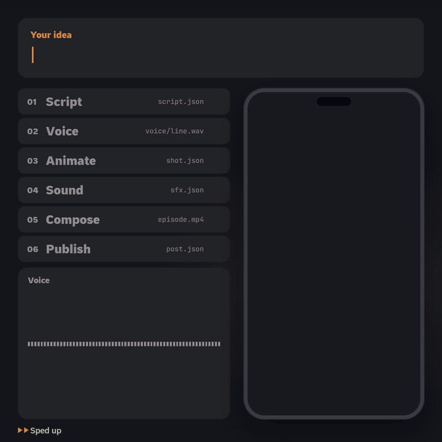

<div align="center">


<a href="https://nj-burrito.github.io/story-wrap/"></a>

# 🎬 Story-Wrap: Claude Code toolkit for Arabic story reels

### ✅ Story idea in. Short animated Arabic reel out. Six stages, each one checked.

**Story-Wrap is a free, open-source (MIT) Claude Code toolkit that turns a story idea into a short animated Arabic reel: script, voice, sound, compose and publish.**

By [Nader Alzghoul (NJ-Burrito)](https://nj-burrito.github.io/) · [Website](https://nj-burrito.github.io/story-wrap/) · [بالعربية](https://nj-burrito.github.io/story-wrap/ar/) · [Release](https://github.com/NJ-Burrito/Story-Wrap/releases/latest)

[](https://nj-burrito.github.io/story-wrap/)


</div>

> ### ⚡ In 10 seconds
> 🎞️ **What:** a toolkit that takes a story idea to a short animated Arabic reel.\
> 🙋 **Who:** creators, educators, Arabic storytellers and developers who want to make their own reels.\
> 🚀 **Start:** five lines in a terminal. [Go ↓](#start)\
> 🧰 **You bring:** Claude Code, an NVIDIA GPU, your own fonts and characters.

> ملخص بالعربية: Story-Wrap أداة مفتوحة المصدر تعمل مع Claude Code، تحوّل فكرتك إلى ريل قصصي متحرك: نص، صوت، رسوم، مؤثرات، ثم نشر. مجانية برخصة MIT، وعليك أن تحضر Claude Code وبطاقة رسومية وخطوطك وشخصياتك. المستودع يحتوي الأداة فقط؛ حلقاتك وخطوطك وصوتياتك وبياناتك تبقى عندك. تحتاج سطر الأوامر وClaude Code، فهذه أداة وليست محررًا بالنقر.

🧭 **Jump to:** [Start](#start) · [Pipeline](#pipeline) · [Why it is safe](#safe) · [Requirements](#requirements) · [Layout](#layout) · [Made with it](#example) · [Licence](#licence) · [More tools](#more)

⚠️ Command line and Claude Code are required. This is not a point-and-click editor.

---

<a id="start"></a>

## 🚀 Start · ⏱️ 5 lines

```bash
git clone https://github.com/NJ-Burrito/Story-Wrap
cd Story-Wrap
mkdir -p ~/.config/story-wrap
cp config/story-wrap.example.env ~/.config/story-wrap/story-wrap.env
uv run tools/daily.py --help
```

✅ These five lines run on a clean checkout and print the command list.\
❌ They do not make a reel. **No sample reel ships yet.**

- 🪟 On Windows, set `PYTHONUTF8=1`.
- 🐍 Python scripts run with uv, never pip: `uv run --with <deps> tools/<script>.py`.
- 📄 Before your first reel you supply fonts, characters and worlds, a voice reference clip and account tokens. Each has an example file in `config/`.

---

<a id="pipeline"></a>

## 🔁 Pipeline · 6 stages, 1 file each

Each stage leaves a file the next one reads. Start with [`pipelines/RUNBOOK.md`](pipelines/RUNBOOK.md).

| # | Stage | What happens | Leaves | Doc |
|---|---|---|---|---|
| 1 | 📝 **Script** | A script and a plan, checked by machine before anything is drawn | `script.json` | [`WRITING`](pipelines/WRITING.md) |
| 2 | 🎙️ **Voice** | A local voice engine on your GPU, one take per line | `work/voice/<ep>/<line>.wav` | [`VOICE`](pipelines/VOICE.md) |
| 3 | 🎨 **Animate** | 2D characters and sets; each shot runs nine checked stages (`tools/shot.py`) | `shot.json` | [`RUNBOOK`](pipelines/RUNBOOK.md) |
| 4 | 🔊 **Sound** | Sound design, mix and audio checks | `sfx.json` | [`SOUND`](bible/sound/SOUND.md) |
| 5 | 🎞️ **Compose** | Captions follow the voice; gates, a critic and a heal loop run until it passes | `captions.json`, `episode.mp4` | [`COMPOSE`](pipelines/COMPOSE.md), [`HEAL`](pipelines/HEAL.md) |
| 6 | 📤 **Publish** | Dry run first; `--go` posts to your own Instagram, Facebook Page and YouTube | `post.json` | [`AUDIENCE`](pipelines/AUDIENCE.md) |

🌍 Arabic is the first language: fully voweled voice text, caption shaping and right-to-left layout. Other languages are possible but untested.

---

<a id="safe"></a>

## 🛡️ Why it is safe to try

- ✅ **Checked before it posts.** Script, voice, every shot and the final reel pass machine gates.
- ✅ **Dry run by default.** Posting does nothing until you pass `--go`, and only to accounts you own.
- ✅ **Your tokens, official APIs.** Instagram, Facebook Page and YouTube, with your own apps. Credentials live only in `~/.config/story-wrap/`, never in the repo.
- ✅ **You own what it makes.** No fonts, characters, voices or art are bundled.
- ✅ **Free.** MIT, and no paid service is called. Your Claude Code usage is yours.

---

<a id="requirements"></a>

## 📋 Requirements

| | You need | Detail |
|---|---|---|
| 🤖 | **Claude Code** | Your own plan. The toolkit runs inside it. |
| 🐍 | **Python and uv** | Python 3.11 or newer for most scripts (a few also run on 3.10), run through uv. |
| 🟩 | **Node and a browser** | Node 18 or newer, and a Chromium for rendering. |
| 🎬 | **ffmpeg** | For audio and video. |
| 🖥️ | **A GPU** | NVIDIA, about 4 GB of free video memory, for the local voice engine. It installs into its own environment; the steps are in [`pipelines/VOICE.md`](pipelines/VOICE.md). |
| 📁 | **Your own assets** | Fonts, characters, worlds, and one CC0 reference clip per voice with its provenance. |
| 🔑 | **Accounts, to post** | Meta and Google developer apps and tokens for Instagram, a Facebook Page and YouTube. Skip them and nothing posts. |
| 🪟 | **System** | Developed and tested on Windows. macOS and Linux are not tested. |

<details>
<summary>⚙️ What you must supply, by config key</summary>

Environment (see `config/story-wrap.example.env`): `STORYWRAP_ROOT`, `SW_FONTS`, `SW_OWN_ACCOUNTS`,
`SW_PAGE_NAME`, `SW_SERIES_NAME`, `SW_INSTAGRAM_URL`, `SW_YOUTUBE_URL`, `SW_YT_CHANNEL_ID`,
`SW_YT_PLAYLIST_TITLE`, `SW_MEDIA_REPO`, `SW_IG_ENV`, `SW_GH_ENV`, `SW_YT_TOKEN`, `SW_LLM_DAILY_TOKENS`.

Credential files (`config/instagram.example.env`, `config/github.example.env`): `IG_USER_ID`, `IG_USERNAME`,
`IG_ACCESS_TOKEN`, `IG_TOKEN_ISSUED`, `FB_PAGE_ID`, `FB_PAGE_TOKEN`, `GH_TOKEN`, plus a YouTube OAuth token JSON
from your own Google project.

Schedule and board settings: `config/schedule.example.json`, `config/board-config.example.json`
(copy them to `board/schedule.json` and `board/config.json`).

</details>

<details>
<summary>🚫 Not included (bring your own)</summary>

- **Fonts.** No font files are shipped. Put your own licensed Arabic fonts in `assets/fonts/` (or point `SW_FONTS` at them).
- **Characters and worlds.** `tools/render/characters/` and `tools/render/worlds/` hold only READMEs; add your own cast and sets.
- **Voices, audio, reference images and videos.** None are included.
- **Third-party skills with a licence conflict.** `svg-character-animation` and `character-rigging` (from
  `calesthio/OpenMontage`, AGPL-3.0 upstream) are not redistributed here. Install them from upstream if you want them.

</details>

---

<a id="layout"></a>

## 🗂️ Layout

<details>
<summary>📂 What is in the repo</summary>

| Path | What it is |
|---|---|
| `tools/` | Python and Node scripts: compose, shot engine, voice, captions, gates, heal loop, posting (`ig.py`, `fb.py`, `yt.py`), engagement, board feed; `tools/tests/` |
| `tools/*_parts/` | The bodies of the three longest tools (`voice.py`, `qg_checks.py`, `calm_compose.py`), split into parts that each entry file loads in order; run and import the entry files as before |
| `tools/vendor/earshot/` | Patched copy of the MIT `earshot` audio-realism package (see its `PATCHED.md`) |
| `pipelines/` | How each stage runs (`RUNBOOK.md` first) |
| `kb/` | Rulebook, guides, quality specs, templates |
| `bible/craft`, `bible/sound` | Craft and sound reference docs |
| `board/` | Local monitor page and server (`serve.py`, `index.html`); data is git-ignored |
| `media/` | The README hero and the social banner (`make_media.py` draws them), and `brand/`: the logo, icons and favicon (`make_brand.py`) |
| `config/` | Example env and JSON files for every value you must supply |
| `.claude/skills/`, `.claude/agents/` | Claude Code skills (`story-wrap` plus MIT/Apache/CC0/CC-BY third-party skills) and role agents |

</details>

---

<a id="example"></a>

## 🎬 Made with Story-Wrap

| | |
|---|---|
| 📖 **Example** | *The Lost Property Office* (مكتب المفقودات), an animated Arabic story series made with Story-Wrap |
| 🔗 **Series page** | <https://nj-burrito.github.io/story-wrap/lost-property-office/> |
| 🌐 **Tool page** | <https://nj-burrito.github.io/story-wrap/> · [بالعربية](https://nj-burrito.github.io/story-wrap/ar/) |

One example of what you can make. It is not part of the toolkit.

---

<a id="licence"></a>

## ⚖️ Third-party notices and licence

- 📜 Story-Wrap is MIT, copyright NJ-Burrito. See [`LICENSE`](LICENSE).
- 🧩 Third-party notices: [`THIRD-PARTY.md`](THIRD-PARTY.md). Each bundled skill keeps its LICENSE and `SOURCE.md`.

<a id="related"></a>

## 🎨 Related / style references

- 🎞️ [Lemo-Opuscar](https://github.com/lemomo-ai/lemo-opuscar) by LemoLab (SecondFirst Pty Ltd): a library of film styles for Claude Code, each a style prompt plus a demo film made in code. Useful as a reference when you pick a look for a reel.
  - Linked only. Nothing from it is copied into this repo. Its code is MIT; its Markdown (style prompts, SKILL.md) is CC BY-NC 4.0 and its demo films CC BY 4.0. Read its LICENSE before reusing anything.

---

<a id="more"></a>

## 🧰 More tools by Nader Alzghoul (NJ-Burrito)

| Tool | What it does |
|---|---|
| 🏠 [Portfolio](https://nj-burrito.github.io/) | Nader's work |
| 🧪 [QA-Wrap](https://nj-burrito.github.io/QA-Wrap/) | Browser bug-report recorder |
| 📑 [Business-Wrap](https://nj-burrito.github.io/Business-Wrap/) | Requirements documents in Arabic and English |
| 🧠 [NJ-Kit](https://nj-burrito.github.io/NJ-Kit/) | Working method for Claude Code |
| 🪢 [NJ-Whip](https://nj-burrito.github.io/NJ-Whip/) | On-screen whip for Claude Code |
| 💼 [Profile-Wrap](https://nj-burrito.github.io/Profile-Wrap/) | LinkedIn posts, your approval first |
| 🧹 [NJ-Flush](https://nj-burrito.github.io/NJ-Flush/) | Free Windows RAM cleaner |
| 🗂️ [NJ-Sort](https://nj-burrito.github.io/NJ-Sort/) | Keeps Windows desktop icons where you put them, even after File Explorer restarts |
